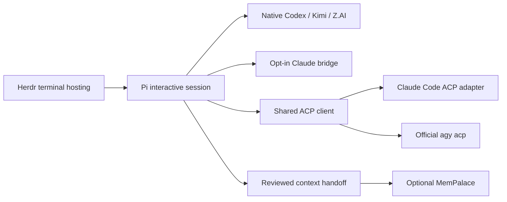

# Architecture

Pi Poly Agent registers provider adapters and handoff commands in a native Pi session.
It has no worker scheduler or orchestration engine.

## Ownership

Pi owns the TUI, agent loop, sessions, native providers and resource system.
Its package manager installs packages and resolves extensions, skills, prompts and themes.
Native Pi project trust controls project resources.
[Herdr](herdr.md) hosts terminals and helpers independently of Poly.
Poly contains no Herdr client or session database.

[`src/extension.ts`](../src/extension.ts) registers native provider wrappers, Google ACP and memory commands.
[`src/providers/claude-acp-extension.ts`](../src/providers/claude-acp-extension.ts) registers Claude ACP commands and models.
[`src/providers/acp.ts`](../src/providers/acp.ts) owns transport, cancellation, permission UI and native ACP bindings.
A binding is saved in Pi history; restoration happens only after explicit discovery confirmation.
A failed load preserves history and requires explicit authorization for a new session.

[`src/policy.ts`](../src/policy.ts) validates the retained configuration and checks runtime activation and billing environments.
[`src/providers/direct-input.ts`](../src/providers/direct-input.ts) supplies the shared direct-input check.
ACP adapters receive only the fresh user prompt.
The bridge uses Pi's transcript and tools for the current human-initiated turn.
Claude ACP sends no tools, system prompt or metadata override.
Native runtime modes remain user-selectable.

## Profile and resources

[`src/profile.ts`](../src/profile.ts) bootstraps `.poly/agent` without copying another Pi profile's credentials.
Bootstrap registers Poly's own extension in native `settings.json` and preserves other resource selections.
The launcher also passes its extension explicitly.
An ordinary Pi launch can select the profile through `PI_CODING_AGENT_DIR` without `PI_POLY_PROFILE`.
[`scripts/cli.ts`](../scripts/cli.ts) forwards package management to the pinned Pi CLI.
[`src/platform/pi-resources.ts`](../src/platform/pi-resources.ts) provides metadata-only resource inspection for doctor.
There is no Poly package manager or executable integration loader.
Retired configuration is ignored with one notice per profile per process.

## Context

[`src/handoff.ts`](../src/handoff.ts) drafts from Pi messages and the previous reviewed handoff.
It does not load retired task records.
The editor allows correction before a confirmed checkpoint is saved to Pi history.
`/handoff-use` prepares text without submitting it.
[`src/memory.ts`](../src/memory.ts) optionally uses MemPalace checkpoint and search operations.
[`src/memory-context.ts`](../src/memory-context.ts) selects bounded, deduplicated knowledge with provenance and certainty labels.
The default retrieval budget is 12,000 characters; configuration permits 256–24,000.
A handoff is limited to 24,000 serialized characters.
Memory failure leaves Pi history and handoffs available.

See [provider configuration](providers.md), [native resources](pi-ecosystem.md), [security limits](security.md) and [migration](migration-v060.md).
