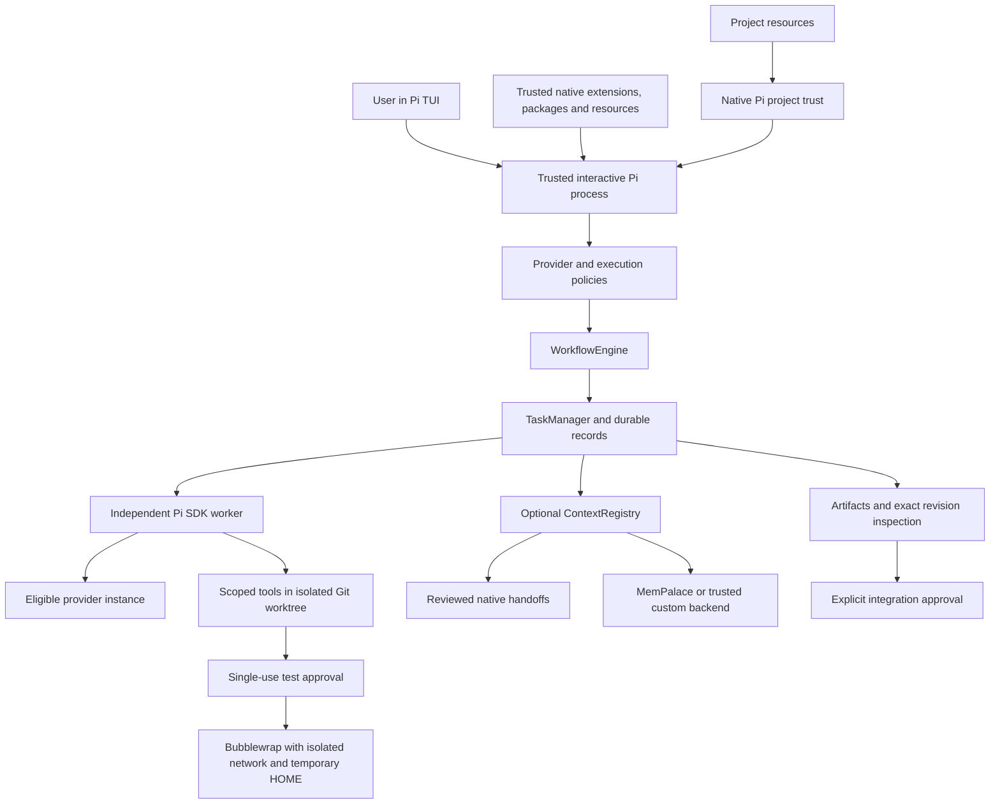

# Composable orchestration architecture

Pi owns the interactive coding environment. Pi Poly Agent coordinates independent tasks through Pi's SDK. Agent definitions and workflow recipes compose the same execution controller; names such as builder or reviewer grant no privileges.

## Ownership

| Owner                      | Responsibilities                                                                                                                            | Implementation                                                                                     |
| -------------------------- | ------------------------------------------------------------------------------------------------------------------------------------------- | -------------------------------------------------------------------------------------------------- |
| Pi 1.5.2                   | TUI, model selection, native providers, agent loop, sessions and conversation history                                                       | Pinned SDK and CLI in [package.json](../package.json)                                              |
| Pi resource system         | Package installation/removal/configuration, extensions, tools, skills, prompts, themes, native project trust and reloads                    | Native `DefaultPackageManager`, `SettingsManager`, `DefaultResourceLoader` and `ProjectTrustStore` |
| Pi Poly Agent              | Provider eligibility and subscription policy, configurable agents, workflow dependencies, approvals, task lifecycle, artifacts and recovery | [Platform contracts](platform.md), [task controller](../src/orchestration/tasks.ts)                |
| Git                        | Source revisions, branches, isolated worktrees and reviewable integration                                                                   | [Worktree implementation](../src/orchestration/worktrees.ts)                                       |
| Context backends           | Bounded, attributed project knowledge                                                                                                       | [Context registry](../src/platform/context.ts), optional MemPalace adapter                         |
| External provider runtimes | Native authentication and private execution state                                                                                           | Official Claude Agent SDK/Claude Code and Antigravity ACP adapters                                 |

## Interactive resources and trust

The [managed launcher](../scripts/cli.ts) uses the isolated `.poly/agent` profile, loads the platform extension explicitly, and retains native Pi resource discovery. Startup is offline. Native `pi install`, `remove`, `list`, and `config` remain authoritative; there is no Poly package installer. Ordinary Pi packages need no Poly adapter. Optional `pi-poly-agent.configuration` JSON adds agents and workflows through an explicit installed-package reference.

Existing suppressed executable user resources need application-code acknowledgment before activation. Native project resources require Pi's separate trust decision. Neither decision copies personal credentials or changes the global Pi installation. See [resource use and compatibility](pi-ecosystem.md) for configuration, filtering, personal references and worker selection.

| Trust domain                                 | Authority and enforcement                                                                                                                                                                                             |
| -------------------------------------------- | --------------------------------------------------------------------------------------------------------------------------------------------------------------------------------------------------------------------- |
| Interactive Pi and trusted native extensions | Application-process authority, including Node.js filesystem, network and process access. No in-process sandbox is claimed. Malicious trusted code can bypass application checks.                                      |
| Project configuration                        | Validated declarative data; cannot install providers/packages, authorize executable integrations or weaken central subscription/sandbox restrictions.                                                                 |
| Project native resources                     | Executable resources remain unloaded until native trust. Trust and reload behavior come from the pinned Pi loader.                                                                                                    |
| Restricted workers                           | Independent transcript and exact model; scoped built-in tools, isolated worktree, no arbitrary executable extension discovery. Instruction text cannot grant privileges.                                              |
| Executable integration modules               | User-owned manifest, explicit application-code trust and reviewed directory inventory by default. Entry-only exceptions explicitly acknowledge unverified imports. Imports outside inventories retain host authority. |
| Skills and prompts                           | Instructional data with source attribution. Selected worker snapshots have path, secret and size checks; supporting scripts are not executed.                                                                         |
| External runtimes                            | Native credential ownership. No OAuth extraction, inference proxy, request rewriting or automatic API fallback. Google consumer ACP remains direct-only; Claude subscription workers remain disabled.                 |

Trusted native extensions use `pi.registerTool`, `pi.registerCommand`, `pi.on` and provider registration directly. `IntegrationHost` remains a narrow version 1 registration seam for worker provider instances, reviewed worker tools/instructions and context backends. Its optional `ui` field is a compatibility reference to Pi's command/event methods, not a second UI API. Native parent provider registration alone does not grant worker eligibility. Removing this public field would impose migration without improving isolation, so it remains supported.

## Execution and policy

[Agent definitions and execution policies](../src/platform/contracts.ts) separate identity/instructions from permissions, tools, resources, context and limits. Security restrictions intersect; limits take the minimum. User and project layers cannot override provider restrictions. Four historical roles remain optional examples and legacy configuration aliases. All tasks currently require isolated Git worktrees, delegation depth one, bounded concurrency and timeouts.

[ProviderRegistry](../src/platform/providers.ts) separates adapter factories from instances. Exact selection or an unambiguous capability match determines an instance. Native Codex, Kimi and Z.AI use Pi providers. Explicit compatible local/API instances reuse Pi's transport. There is no silent model, endpoint, authentication or billing substitution. Eligibility is rechecked at worker admission, initialization and provider invocation.

[TaskManager](../src/orchestration/tasks.ts) owns admission, atomic persistence, host leases, concurrency, cancellation, results, snapshots and integration checks. [WorkflowEngine](../src/platform/workflows.ts) calls that same interface for bounded acyclic graphs. `needs` controls dependencies, `contextFrom` transfers selected artifacts, and `inspect` targets an exact snapshot. Every dispatch requires approval. Implementation/review is an optional recipe, with no separate execution engine. See [workflow configuration](platform.md) and [operational recovery](workflows.md).

The [worker runner](../src/orchestration/runner.ts) creates an independent `createAgentSession`, `ModelRuntime` and `SessionManager`. Its executable resource loader is disabled. A separate data-only native discovery pass resolves explicitly selected `pi:skill:NAME` and `pi:prompt:NAME` snapshots from installed resources. These do not grant supporting-file access, script execution, template arguments or native hooks. Approved programmatic worker tools remain trusted host code; permission metadata is not a JavaScript sandbox.

Built-in [file tools](../src/orchestration/tools.ts) pass checked absolute paths to Pi, block recognized sensitive paths and reject symlinks. Read requires the exact checked target to be an existing regular file; missing paths fail before filename fallback. The [runner](../src/orchestration/runner.ts) selects sequential tool execution so worker commands and file access do not overlap. Unrelated host-process filesystem races remain outside that guarantee. Pattern screening cannot identify every secret. Single-use approved tests run with an isolated network, temporary HOME, system runtimes and the whole task worktree. Normal host credential stores and the parent Git common directory are not mounted; credentials already in source remain visible. Sandbox failure has no host-shell fallback.

[Host Git](../src/orchestration/worktrees.ts) pins parent-derived task metadata, verifies the gitfile and refuses nested repository metadata names, including case variants, before registered task operations. It walks all directories without following symlinks, including dependencies. Synchronous read-only view queries share one worktree walk per view. The runner executes worker tools sequentially. Every checked Git entry rejects active preparation from its approval wait until command settlement, including workflow context and checkpoint reads. UI diff, cleanup, recovery, review and integration actions reuse that guard and recheck after yielding approvals. Other Git commands invalidate the shared check. Unrelated host-process mutation remains outside this guarantee. A refusal requires manual inspection. Hooks and filesystem monitoring are disabled; diff/status calls ignore submodules. Unregistered task-store paths cannot fall back to discovery. The sandbox additionally mounts the top-level gitfile read-only.

[Patch capture](../src/orchestration/worktrees.ts) sends Git output directly to owner-only temporary spools and secret-screens it in 64 KiB reads. Pinned metadata, the nested-repository walk, Git overrides and environment filtering apply to both capture paths. Neither completion nor recovery buffers the whole patch. Spools are closed and removed on normal success or failure; disk availability and the 15-second Git timeout remain resource requirements. Non-patch metadata captures retain a 2097152-byte buffer limit with a lower-bound overflow message and manual-inspection guidance. Patch and NUL-delimited file-index reads do not use that limit.

New `diff` artifacts contain a bounded view, the base and snapshot revision, and inspection commands. The full committed patch lives in Git rather than the artifact. [Review views](../src/orchestration/review-view.ts) bound the entire output, including the file index and commands. Listed omitted files have added/removed counts or an explicit unavailable-count label when Git reports binary; additional files are counted and remain discoverable through pagination and the full `git diff --numstat` command. Revision-specific commands use the shared Git directory so they survive worktree cleanup. A raw-status query is matched to the NUL-delimited filename index before the single patch stream is collected. A typechange has two sections under one file budget; both are shown together or the file is marked not shown. Unexpected status, name or section-count mismatches fail closed. See [patch grouping](../src/orchestration/review-patches.ts). The patch stream is secret-screened in full while bounded sections are collected for display; completion screens source before its snapshot and builds only the revision-specific view. Unsafe characters are escaped without replacing source lines with binary summaries. A shared no-renames option set and unquoted NUL-delimited names preserve both sides of control-file renames.

Packets and `review_diff` page one ordered changed-file index, including names marked `[refused by path policy]` whose patches are inaccessible. Canonical pages contain up to 32 entries or about 1024 index characters, regardless of the view budget; an oversized first entry is retained for progress. The reported `Next file offset` addresses that same list everywhere. `review_diff` accepts the special path `"."` and optional `offset` for index-only output. Patch requests must select no changed file or exactly the requested literal filename, and every returned name must satisfy the shared [source-path policy](../src/orchestration/path-policy.ts). Directories are refused even when deleted or replaced in the reviewed revision. [Task context](../src/orchestration/context.ts) selects whole entries and names parts omitted for budget. The [controller](../src/orchestration/tasks.ts) sends the approved packet unchanged, validates that its exact required view appears once, and rejects oversized packets with their size, effective budget and excess. It never inserts another view or slices approved knowledge. The required view gets at most 6000 characters from the actual context-part slot, after reserving 384 characters for omission notices and 2 for separation. Draft assembly and dispatch use the same calculation. The view budget reserves the actual pagination length. Insufficient space for metadata and the canonical index page is refused before editing with the exact required size and configured budget, rather than omitting the view. A budget equal to that minimum fits; one character less refuses. If dispatch finds that a fitting view is missing, it explains that the packet was changed or omitted it.

[Integration](../src/orchestration/tasks.ts) requires a completed read-only review task bound to the exact snapshot, unchanged parent/source revisions and separate human confirmation. This record validates task/revision association, not review quality or complete tool coverage. A distinct model is required by recipes that declare `distinctModelFrom`, not by every review task.

## Persistence and context

The v0.5 inspection interface in `src/doctor.ts` reports configuration provenance, effective policies and native resource metadata without importing integrations, resolving credentials or probing namespaces. `/poly-doctor` uses Pi's own notification UI. Explicit CLI profile/project selection enables isolated testing without changing the primary profile. Native resource snapshots preserve user/project scopes through Pi's settings storage interface.

User commands select arbitrary configured agents, workflows and tasks through native pickers. These call the same task/workflow controllers as explicit command arguments. A separately approved qualification probe uses an ordinary tool-free task with an optional persisted request budget. The runner enforces generation count and requested output limits at invocation; replacements intersect the old budget. Normal tasks retain their existing timeout and permission behavior. No probe is launched automatically.

Task and workflow records publish through synced temporary files and atomic rename. On restart, unfinished execution becomes interrupted without replay. Completed results, artifacts, local session references, branches and review revisions remain inspectable. Worktree cleanup and pruning preserve task history. Missing worktrees or metadata produce diagnostics, with no Git execution inside unavailable directories. Completed review associations survive reviewer cleanup when the builder snapshot remains unchanged. See [restoration](../src/orchestration/tasks.ts) and [recovery tests](../tests/cleanup-recovery.test.ts). Explicit task recovery creates a replacement; it does not resume provider-private execution state. Explicit workflow continuation revalidates completed checkpoints and creates a linked run with new approvals for pending tasks. Uncertain execution requires separate recovery and cannot be replayed automatically.

[ContextRegistry](../src/platform/context.ts) enforces project isolation, attribution, secret screening, deduplication and budgets. Native-only context uses reviewed handoffs; task-result transfer uses local artifacts. MemPalace is optional and uses supported MCP retrieval/checkpoint interfaces against an existing palace. Missing backends do not prevent tasks from running. Generic backend writes require the caller's approval flow. Pi owns active history, tasks own execution state, Git owns source, and providers own private state.

The MemPalace adapter reuses item-level checkpoint deduplication. Agent diary and logstream would duplicate local task events, so orchestration does not depend on either. No palace is initialized or overwritten, no transcript mining runs, and agent memory remains separate from a personal vault. Memory handoffs never automatically submit prompts to Google ACP.

## Integrity and limits

[Executable integration integrity](security.md#executable-integration-integrity) identifies reviewed files and remaining trust explicitly. Local inventories detect changed, missing, added, symlinked and special files before import. Native package dependencies follow their own installation and lockfile behavior. Neither inventory nor lockfile attests arbitrary external or dynamic imports, prevents filesystem races, or makes trusted code safe.

The platform adds no inference client, package manager, terminal framework, daemon, task database inside memory, or second extension runtime. Remaining qualification and distribution work is recorded in [the roadmap](roadmap.md). Offline provider fixtures establish local behavior only; live provider qualification remains explicitly authorized and pending.

## Reviewed source and reuse decisions

The review used these immutable upstream snapshots. npm tarball integrity and the entire resolved dependency graph are recorded in `package-lock.json`.

| Reference                                                                                                                            | Reviewed revision                          | Decision                                                                                                                                                                                                                                                |
| ------------------------------------------------------------------------------------------------------------------------------------ | ------------------------------------------ | ------------------------------------------------------------------------------------------------------------------------------------------------------------------------------------------------------------------------------------------------------- |
| [Pi](https://github.com/badlogic/pi-mono/tree/780bf31fcaeb252fa9b68df3964c735eae75bde3)                                              | `780bf31fcaeb252fa9b68df3964c735eae75bde3` | Reuse TUI, sessions, provider factories, and extensions. Pin compatible npm packages at 1.5.2. The inspected repository head was 1.6.0; installed 1.5.2 declarations and runtime were also checked.                                                     |
| [pi-claude-bridge](https://github.com/elidickinson/pi-claude-bridge/tree/5ea9bb88bd54395c1fe38cc95ec2ce1dbdcf15cc)                   | `5ea9bb88bd54395c1fe38cc95ec2ce1dbdcf15cc` | Pin npm 0.13.0. Reuse its SDK interface and stream conversion. Do not load its lifecycle hooks while disabled.                                                                                                                                          |
| [pi-antigravity-acp-provider](https://github.com/zacbemis/pi-antigravity-acp-provider/tree/4e827f6feeff03f0339b129cc1b9a59157a4cef7) | `4e827f6feeff03f0339b129cc1b9a59157a4cef7` | Reviewed `src/provider.ts`, `src/config.ts`, runtime launch, authentication, and permission handling. Do not install it. Its default `yolo` mode, automatic updates, credential-file inspection, and auth-management paths exceed this profile's scope. |
| [pi-agy-acp](https://github.com/fdkevin0/pi-agy-acp/tree/b84aa9c955456fda18f55a47356a51b2a0046426)                                   | `b84aa9c955456fda18f55a47356a51b2a0046426` | Reviewed host, configuration, runtime, and provider registration. Its multi-session Pi-tool bridge and automatic continuation are unnecessary for this direct-interaction slice.                                                                        |
| [T3 Code](https://github.com/pingdotgg/t3code/tree/7ef7ba0e3b1bc0582e44f1379bff1cc5559cf0d2)                                         | `7ef7ba0e3b1bc0582e44f1379bff1cc5559cf0d2` | Reuse the architectural pattern of native runtimes, ACP sessions, model discovery, and in-interface approval. No web frontend or orchestration framework is copied.                                                                                     |
| [Ben Davis's setup](https://github.com/davis7dotsh/my-pi-setup/tree/5a0863f442402aa35cb0830805d67639957c7172)                        | `5a0863f442402aa35cb0830805d67639957c7172` | Reviewed subagent registration, child sessions, summaries, and dependency manifests. Adapt the independent Pi SDK session pattern. Do not install its Effect-based manager or native Claude/Codex harness backends.                                     |

T3 Code's `apps/server/src/provider/acp/AntigravityAcpSupport.ts` includes a legacy client-name compatibility path. This project always advertises `pi-poly-agent`. An official runtime that refuses that identity remains unsupported. No endpoint or client-identity impersonation is added.

## Orchestrator reuse assessment

The evaluated [nicobailon/pi-subagents revision fb7ce3c](https://github.com/nicobailon/pi-subagents/tree/fb7ce3ce7524e35b241a2aa6ae13cd574dd1c593) identifies itself as 0.89.2. Its structured delegation, cancellation, required-child-extension, and capability-ceiling interfaces were inspected, along with its resource discovery and workflow process code. It is maintained and supports much more than this slice, including workflow scripting, inspector integrations, shared session context, and intercom transport. Installing the whole extension would add competing task ownership and resource-loading paths. Its public delegation interface is an extension-event protocol, rather than a small standalone session executor. It remains uninstalled.

Ben Davis's `extensions/subagents/src/backends/pi.ts` already uses Pi SDK sessions, subscriptions, abort, and disposal. This project reuses those upstream Pi primitives directly, with narrower resource and tool permissions. His workflow controller, background-terminal manager, result delivery, and manifests were inspected as UI and lifecycle references. No source was copied and no separate orchestrator dependency was added.

T3's [orchestration-v2 documentation](https://github.com/pingdotgg/t3code/tree/7ef7ba0e3b1bc0582e44f1379bff1cc5559cf0d2/docs/orchestration-v2) explicitly describes a target architecture. The same source snapshot also contains concrete `RunExecutionService`, `RuntimePolicy`, `ContextHandoffService`, task-folder, and cancellation tests. Those implementations inform capability checks, task identity, explicit handoffs, and cancellation; the documents alone are not evidence that every proposed feature has shipped. Pi Poly does not import T3's graph, event-store, MCP orchestrator, or web UI.
