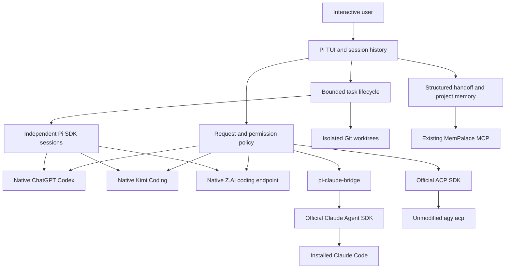

# Architecture

Pi owns the interactive terminal, model picker, tools, and durable conversation tree. The launcher in `scripts/cli.ts` selects an isolated agent directory and loads only `src/extension.ts`. It disables discovered extensions, skills, prompt templates, themes, and startup network refreshes. Repository AGENTS.md files remain part of Pi's native instruction loading.

## Modules and seams

`src/profile.ts` contains the installation and validation interface. It creates files exclusively, detects symlinked profile paths, preserves unknown settings, and verifies activated runtime checksums. `.poly/agent` holds this profile's Pi auth and sessions. Global installations remain separate.

`src/policy.ts` contains activation, billing, and environment rules. `src/orchestration/capabilities.ts` exposes direct interaction, delegation, background execution, concurrency, streaming, cancellation, persistence, tools, editing, and authentication capabilities. Native transport wrappers enforce the policy at request time. A Pi event-handler exception alone is insufficient, since Pi reports some extension errors and continues. The implementation therefore gates the provider stream itself.

`src/providers/acp.ts` is the ACP adapter. Its connection factory is the seam shared by the official subprocess transport and mocked test transports. It launches the checksum-pinned `agy` executable with the `acp` argument, identifies itself honestly, selects `oauth-personal` through ACP, and requires the runtime's `default` permission mode. It advertises no client filesystem or terminal capabilities and supplies no MCP servers.

`src/providers/stream.ts` converts ACP text, reasoning, and tool activity into Pi's event stream. The adapter sends only the direct human prompt. It does not forward Pi's private transcript or silently transfer another provider's context. The official Google agent owns execution tools. Pi's tool approval gate applies to Pi-owned tools used by native providers and the Claude bridge.

`src/memory.ts` uses MemPalace's supported MCP client interface. A handoff has an objective, completed work, decisions, questions, files, sourced facts with verification flags, hypotheses, and session/provider/Git provenance. Pi custom entries retain the reviewed handoff and last checkpoint digest. MemPalace receives independent durable knowledge items plus a separate structured checkpoint, without the conversation transcript. `src/memory-context.ts` decodes MCP records and selects sourced context within a configurable budget; `src/handoff.ts` drafts and parses the editable Markdown handoff.

## Reviewed source and reuse decisions

The review used these immutable upstream snapshots. npm tarball integrity and the entire resolved dependency graph are recorded in `package-lock.json`.

| Reference                                                                                                                            | Reviewed revision                          | Decision                                                                                                                                                                                                                                                |
| ------------------------------------------------------------------------------------------------------------------------------------ | ------------------------------------------ | ------------------------------------------------------------------------------------------------------------------------------------------------------------------------------------------------------------------------------------------------------- |
| [Pi](https://github.com/badlogic/pi-mono/tree/780bf31fcaeb252fa9b68df3964c735eae75bde3)                                              | `780bf31fcaeb252fa9b68df3964c735eae75bde3` | Reuse TUI, sessions, provider factories, and extensions. Pin compatible npm packages at 1.5.2. The inspected repository head was 1.6.0; installed 1.5.2 declarations and runtime were also checked.                                                     |
| [pi-claude-bridge](https://github.com/elidickinson/pi-claude-bridge/tree/5ea9bb88bd54395c1fe38cc95ec2ce1dbdcf15cc)                   | `5ea9bb88bd54395c1fe38cc95ec2ce1dbdcf15cc` | Pin npm 0.13.0. Reuse its SDK interface and stream conversion. Do not load its lifecycle hooks while disabled.                                                                                                                                          |
| [pi-antigravity-acp-provider](https://github.com/zacbemis/pi-antigravity-acp-provider/tree/4e827f6feeff03f0339b129cc1b9a59157a4cef7) | `4e827f6feeff03f0339b129cc1b9a59157a4cef7` | Reviewed `src/provider.ts`, `src/config.ts`, runtime launch, authentication, and permission handling. Do not install it. Its default `yolo` mode, automatic updates, credential-file inspection, and auth-management paths exceed this profile's scope. |
| [pi-agy-acp](https://github.com/fdkevin0/pi-agy-acp/tree/b84aa9c955456fda18f55a47356a51b2a0046426)                                   | `b84aa9c955456fda18f55a47356a51b2a0046426` | Reviewed host, configuration, runtime, and provider registration. Its multi-session Pi-tool bridge and automatic continuation are unnecessary for this direct-interaction slice.                                                                        |
| [T3 Code](https://github.com/pingdotgg/t3code/tree/7ef7ba0e3b1bc0582e44f1379bff1cc5559cf0d2)                                         | `7ef7ba0e3b1bc0582e44f1379bff1cc5559cf0d2` | Reuse the architectural pattern of native runtimes, ACP sessions, model discovery, and in-interface approval. No web frontend or orchestration framework is copied.                                                                                     |
| [Ben Davis's setup](https://github.com/davis7dotsh/my-pi-setup/tree/5a0863f442402aa35cb0830805d67639957c7172)                        | `5a0863f442402aa35cb0830805d67639957c7172` | Reviewed subagent registration, child sessions, summaries, and dependency manifests. Adapt the independent Pi SDK session pattern. Do not install its Effect-based manager or native Claude/Codex harness backends.                                     |

T3 Code's `apps/server/src/provider/acp/AntigravityAcpSupport.ts` includes a legacy client-name compatibility path. This project always advertises `pi-poly-agent`. An official runtime that refuses that identity remains unsupported. No endpoint or client-identity impersonation is added.

## Memory backend evaluation

The memory integration reuses MemPalace's supported MCP interfaces. The reviewed `mempalace/mcp_server/tools_diary.py` implements `tool_checkpoint`, which deduplicates individual items and can append a diary entry. The `mempalace_checkpoint` operation is sufficient for this milestone.

The agent diary stores an additional chronological journal. A duplicate diary entry on every checkpoint would add repeated information, so this slice does not write one. The logstream stores immutable coordination events and artifacts. Its append-only SQLite coordination layer supports exact task events and artifacts, but would duplicate the local task lifecycle in this milestone. Orchestration therefore does not depend on logstream or a running MemPalace server. This slice neither creates a coordination stream nor mines transcripts.

The existing installation is discovered through `mempalace-mcp` on an absolute PATH entry and MemPalace's configuration directory. Discovery checks for existing palace storage. It never runs initialization. Each Git common directory maps to a deterministic project wing, so worktrees share project knowledge. Explicit `sharedWings` enable additional retrieval; saves always target the current project.

## Independent worker sessions

`src/orchestration/tasks.ts` owns task admission, bounded concurrency, cancellation, durable status, and structured results. Its runner interface is the seam for independent execution. The production adapter in `runner.ts` uses Pi's pinned `createAgentSession`, `ModelRuntime`, `SessionManager`, settings, and resource loader. Tests replace only provider transports for the implementation-and-review integration scenario.

Children have a fresh transcript, explicit model, independent native Pi session files, no discovered extensions, skills, MCP configuration, or automatic context files. Their focused task packet identifies the parent, role, acceptance criteria, Git revision, worktree, selected knowledge, and prior findings. Parent transcript copying, recursive delegation, provider switching, automatic compaction, and retries are unavailable. The provider guard rechecks policy and environment at invocation after authentication resolution. Child histories receive complete screened messages and fixed error descriptions; progress reports activity without raw provider bodies.

`tools.ts` adapts Pi's read, edit, and write tools to project-scoped paths. Read-only roles receive no editing or shell tool. Independent reviewers also receive a read-only per-file diff tool against the builder's original base. Builder test commands require a single-use approval and a Bubblewrap sandbox. The sandbox has no provider credentials, network, host HOME, or Git common directory. A failed sandbox never falls back to ordinary shell execution.

`worktrees.ts` uses normal Git worktrees and branches. Admission refuses dirty parent trees. Successful builders produce an application-owned snapshot commit with hooks disabled, retaining the original base. Reviewers get a separate worktree at that snapshot. Integration checks the unchanged parent and builder snapshot and requires a completed review plus final UI approval before cherry-picking. Dirty or active worktrees cannot be automatically removed.

`src/orchestration/extension.ts` registers Pi commands and two tools explicitly from the managed extension. It displays task states and returns completion messages without starting another turn. It cancels tasks on session switching and shutdown. The task record persists separately from MemPalace knowledge. A process restart marks unfinished work interrupted; there is no automatic worker replay or provider-private recovery.

## Orchestrator reuse assessment

The evaluated [nicobailon/pi-subagents revision fb7ce3c](https://github.com/nicobailon/pi-subagents/tree/fb7ce3ce7524e35b241a2aa6ae13cd574dd1c593) identifies itself as 0.89.2. Its structured delegation, cancellation, required-child-extension, and capability-ceiling interfaces were inspected, along with its resource discovery and workflow process code. It is maintained and supports much more than this slice, including workflow scripting, inspector integrations, shared session context, and intercom transport. Installing the whole extension would add competing task ownership and resource-loading paths. Its public delegation interface is an extension-event protocol, rather than a small standalone session executor. It remains uninstalled.

Ben Davis's `extensions/subagents/src/backends/pi.ts` already uses Pi SDK sessions, subscriptions, abort, and disposal. This project reuses those upstream Pi primitives directly, with narrower resource and tool permissions. His workflow controller, background-terminal manager, result delivery, and manifests were inspected as UI and lifecycle references. No source was copied and no separate orchestrator dependency was added.

T3's [orchestration-v2 documentation](https://github.com/pingdotgg/t3code/tree/7ef7ba0e3b1bc0582e44f1379bff1cc5559cf0d2/docs/orchestration-v2) explicitly describes a target architecture. The same source snapshot also contains concrete `RunExecutionService`, `RuntimePolicy`, `ContextHandoffService`, task-folder, and cancellation tests. Those implementations inform capability checks, task identity, explicit handoffs, and cancellation; the documents alone are not evidence that every proposed feature has shipped. Pi Poly does not import T3's graph, event-store, MCP orchestrator, or web UI.

## Remaining design limits

Task persistence is local and assumes one Pi task host per project. Interrupted workers can be inspected but cannot yet resume. Role instructions and source documents are untrusted model context, not permission grants. Research is limited to scoped project files and supplied documentation; no network research tool is exposed. Custom open-weight endpoints need distinct, explicitly billed provider instances and are not yet supported.

Knowledge identities omit session IDs and timestamps; source changes and paraphrases can still create multiple backend records. Retrieval deduplicates normalized overlapping items, preserves conflicting claims, and does not infer truth or resolve contradictions. Diary/logstream automation, automatic verified-fact extraction, and transport retries that prove no operation was accepted remain follow-ups.

## v0.3 lifecycle and recovery

`TaskManager` remains the execution controller. `storage.ts` publishes task records with exclusive temporary files, file sync, atomic rename, and directory sync. It keeps one PID/start-identity host lease per project/profile. Records add optional fields, preserving v0.2 compatibility without a migration. A `created` intent is persisted before Git creates a worktree; normal execution still uses running/completed/failed/canceled/timed_out/interrupted. Review and integration states are separate metadata so a completed worker result remains stable.

Restart reads prior records, reports damaged or missing records, reconciles worktree availability, and marks owned abandoned execution interrupted. It never replays prompts. Explicit recovery starts a replacement with a new task/session ID and preserved source snapshot. A single commit against the original base includes recovered edits and subsequent implementation. Existing Pi session references are local inspection artifacts. Although the pinned SDK exposes `SessionManager.open`, pending tool and interrupted-generation recovery have not been qualified, so this controller deliberately does not reopen workers for execution.

`preparation.ts` recognizes project manifests and provides approved Node artifact copying, with prerequisite guidance for Python and Go. `errors.ts` maps raw provider failures to fixed categories before they reach Pi history. `presentation.ts` supplies compact task lines and detailed results. `/implement` calls the same launch/dispatch interface as existing commands and offers a separate read-only review. Session-generation checks stop stale guided offers after a switch. Integration rechecks the exact reviewed commit after approval and records intent before cherry-pick.

`context.ts` selects whole attributed entries within a budget. Worker launch queries optional project memory using the specific task brief. Memory failure leaves execution available. Task state, session references, review progress, and integration intent remain in the local profile, never in MemPalace logstream. Reviewed durable knowledge still uses the existing handoff/checkpoint interface.
