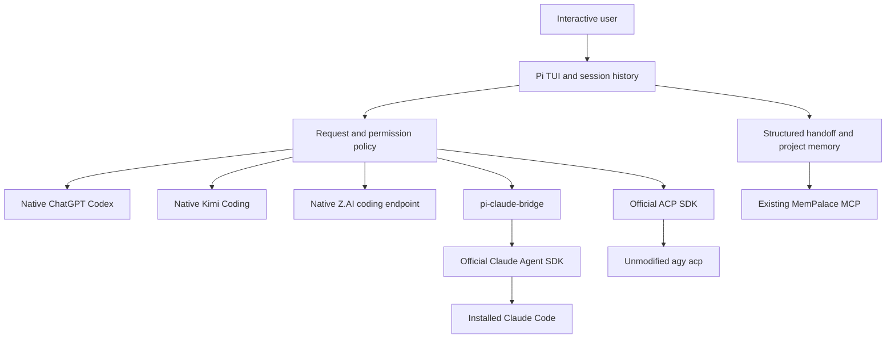

# Architecture

Pi owns the interactive terminal, model picker, tools, and durable conversation tree. The launcher in `scripts/cli.ts` selects an isolated agent directory and loads only `src/extension.ts`. It disables discovered extensions, skills, prompt templates, themes, and startup network refreshes. Repository AGENTS.md files remain part of Pi's native instruction loading.

## Modules and seams

`src/profile.ts` contains the installation and validation interface. It creates files exclusively, detects symlinked profile paths, preserves unknown settings, and verifies activated runtime checksums. `.poly/agent` holds this profile's Pi auth and sessions. Global installations remain separate.

`src/policy.ts` contains provider capabilities and activation rules. Native transport wrappers enforce the policy at request time. A Pi event-handler exception alone is insufficient, since Pi reports some extension errors and continues. The implementation therefore gates the provider stream itself.

`src/providers/acp.ts` is the ACP adapter. Its connection factory is the seam shared by the official subprocess transport and mocked test transports. It launches the checksum-pinned `agy` executable with the `acp` argument, identifies itself honestly, selects `oauth-personal` through ACP, and requires the runtime's `default` permission mode. It advertises no client filesystem or terminal capabilities and supplies no MCP servers.

`src/providers/stream.ts` converts ACP text, reasoning, and tool activity into Pi's event stream. The adapter sends only the direct human prompt. It does not forward Pi's private transcript or silently transfer another provider's context. The official Google agent owns execution tools. Pi's tool approval gate applies to Pi-owned tools used by native providers and the Claude bridge.

`src/memory.ts` uses MemPalace's supported MCP client interface. A handoff has an objective, completed work, decisions, questions, files, sourced facts with verification flags, hypotheses, and session/provider/Git provenance. Pi custom entries retain the reviewed handoff and last checkpoint digest. MemPalace receives the structured checkpoint, rather than the conversation transcript.

## Reviewed source and reuse decisions

The review used these immutable upstream snapshots. npm tarball integrity and the entire resolved dependency graph are recorded in `package-lock.json`.

| Reference                                                                                                                            | Reviewed revision                          | Decision                                                                                                                                                                                                                                                |
| ------------------------------------------------------------------------------------------------------------------------------------ | ------------------------------------------ | ------------------------------------------------------------------------------------------------------------------------------------------------------------------------------------------------------------------------------------------------------- |
| [Pi](https://github.com/badlogic/pi-mono/tree/780bf31fcaeb252fa9b68df3964c735eae75bde3)                                              | `780bf31fcaeb252fa9b68df3964c735eae75bde3` | Reuse TUI, sessions, provider factories, and extensions. Pin compatible npm packages at 1.5.2. The inspected repository head was 1.6.0; installed 1.5.2 declarations and runtime were also checked.                                                     |
| [pi-claude-bridge](https://github.com/elidickinson/pi-claude-bridge/tree/5ea9bb88bd54395c1fe38cc95ec2ce1dbdcf15cc)                   | `5ea9bb88bd54395c1fe38cc95ec2ce1dbdcf15cc` | Pin npm 0.13.0. Reuse its SDK interface and stream conversion. Do not load its lifecycle hooks while disabled.                                                                                                                                          |
| [pi-antigravity-acp-provider](https://github.com/zacbemis/pi-antigravity-acp-provider/tree/4e827f6feeff03f0339b129cc1b9a59157a4cef7) | `4e827f6feeff03f0339b129cc1b9a59157a4cef7` | Reviewed `src/provider.ts`, `src/config.ts`, runtime launch, authentication, and permission handling. Do not install it. Its default `yolo` mode, automatic updates, credential-file inspection, and auth-management paths exceed this profile's scope. |
| [pi-agy-acp](https://github.com/fdkevin0/pi-agy-acp/tree/b84aa9c955456fda18f55a47356a51b2a0046426)                                   | `b84aa9c955456fda18f55a47356a51b2a0046426` | Reviewed host, configuration, runtime, and provider registration. Its multi-session Pi-tool bridge and automatic continuation are unnecessary for this direct-interaction slice.                                                                        |
| [T3 Code](https://github.com/pingdotgg/t3code/tree/7ef7ba0e3b1bc0582e44f1379bff1cc5559cf0d2)                                         | `7ef7ba0e3b1bc0582e44f1379bff1cc5559cf0d2` | Reuse the architectural pattern of native runtimes, ACP sessions, model discovery, and in-interface approval. No web frontend or orchestration framework is copied.                                                                                     |
| [Ben Davis's setup](https://github.com/davis7dotsh/my-pi-setup/tree/5a0863f442402aa35cb0830805d67639957c7172)                        | `5a0863f442402aa35cb0830805d67639957c7172` | Reviewed subagent registration, child sessions, summaries, and dependency manifests. Keep these as later workflow references. Its delegation tools are not installed.                                                                                   |

T3 Code's `apps/server/src/provider/acp/AntigravityAcpSupport.ts` includes a legacy client-name compatibility path. This project always advertises `pi-poly-agent`. An official runtime that refuses that identity remains unsupported. No endpoint or client-identity impersonation is added.

## Memory backend evaluation

The memory integration reuses MemPalace's supported MCP interfaces. The reviewed `mempalace/mcp_server/tools_diary.py` implements `tool_checkpoint`, which deduplicates individual items and can append a diary entry. The `mempalace_checkpoint` operation is sufficient for this milestone.

The agent diary stores an additional chronological journal. A duplicate diary entry on every checkpoint would add repeated information, so this slice does not write one. The logstream stores immutable coordination events and artifacts. It is appropriate for later delegated work, but introduces no benefit for a single user submitting a handoff. This slice neither creates a coordination stream nor mines transcripts.

The existing installation is discovered through `mempalace-mcp` on an absolute PATH entry and MemPalace's configuration directory. Discovery checks for existing palace storage. It never runs initialization. Each Git common directory maps to a deterministic project wing, so worktrees share project knowledge. Explicit `sharedWings` enable additional retrieval; saves always target the current project.
